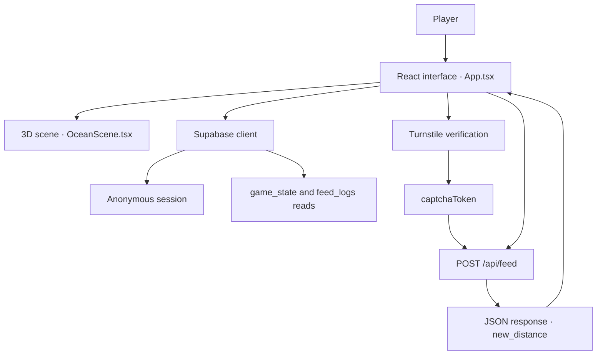

<div align="center">

# 🦈 SAVE LOLLIE 🐟

### Two feeding buttons. One shared fate. A web game built as an AI development experiment.

**3D Web Game · Collective Decision-Making · Social Experiment Concept · Built with Gemini**

> Would you feed the shark—or help Lollie escape?

</div>

Save Lollie is a browser-based project that turns a shark chasing a small fish into a shared decision-making experience. Players have two choices: feed the shark or support Lollie. The interface presents these actions as decreasing or increasing the distance between the two characters.

The project has two main purposes. The first is to gamify a social experiment concept: observing which character people choose to support in a predator–prey scenario. The second is to **test whether the Gemini chatbot can take a software project from an initial idea to a working product.**

Save Lollie can therefore be viewed as an **AI-assisted development case study**, combining game design, 3D visualization, anonymous sessions, remote data access, bot verification, and user interaction in one experience.

| Project overview | Description |
| --- | --- |
| Project name | Save Lollie; package name: `savelollie` |
| Application type | Browser-based web game with a 3D scene |
| Core interaction | Choose to feed the shark or support Lollie |
| Shared state | Distance between the characters, read from Supabase |
| Participation model | Anonymous sessions and a daily participation limit design |
| Development experiment | Testing Gemini's ability to build a project from start to finish |
| Interface language | English |
| Documentation scope | Static review of the 16 supplied source and configuration files |

> **Scope:** This README combines the project owner's stated objectives with behavior visible in the supplied code. The server endpoint implementation, database schema, production environment, and 3D model files are not included in the reviewed source package. This document is not a live system test or a security audit.

---

## 1. The Story: A Small Choice with a Shared Outcome

The game centers on an immediately understandable dilemma. As the shark approaches Lollie, the player decides which side to support. The intervention is designed to contribute to a shared distance value read from a remote source, rather than produce a score limited to one player's screen.

Three design principles shape the experience:

- **Low barrier to participation:** Two feeding buttons replace movement controls, a lengthy tutorial, and an account registration form. An anonymous session is created in the background, while human verification is required before an intervention.
- **Visible consequences:** The distance display, character positions, and sound rhythm reinforce the same sense of approaching danger.
- **Shared responsibility:** Reading the distance from a central source creates the idea of participating in a collective outcome.

The central social question is simple: **Which character will people choose to support?** Perceived danger, attachment to a character, and the apparent presence of other participants are related questions the design could explore. These are potential research questions; the supplied files do not contain real user findings or statistical analysis answering them.

## 2. The Second Experiment: Can Gemini Build an Entire Project?

The project was created to test more than Gemini's ability to generate isolated code snippets. Its stated aim was to explore whether a chatbot could connect multiple components around a coherent product idea.

The technical scope extends beyond a single screen:

| Development area | Implementation in the project |
| --- | --- |
| Turning an idea into an interaction | Two characters, two choices, and a shared distance-based game loop |
| Interface development | Distance panel, feeding buttons, activity messages, and an ending screen |
| 3D scene construction | Models, camera, lighting, fog, bait, and particles |
| External service integration | Supabase client, anonymous sessions, and database queries |
| Request handling | Sending feeding actions through `/api/feed` |
| Bot verification integration | Cloudflare Turnstile component and verification token |
| Sensory feedback | Distance-dependent sound generated with the Web Audio API |
| Project tooling | TypeScript, Vite, ESLint, and npm scripts |

**Gemini's role is in the development process.** The supplied application code contains no Gemini API calls, language model, learning opponent, or model-based decision engine. The shark's movement follows rules that map the distance value to scene coordinates.

The project owner's account establishes the development objective; the source files show the resulting implementation. The Gemini version, prompt history, amount of manual intervention, and development duration were not supplied. The code therefore does not establish a success rate or demonstrate fully autonomous development.

## 3. Gameplay and Rules

### Opening the game

The application's distance state initially contains `10000`. It then checks for an existing anonymous session or creates a new one, reads the distance from `game_state`, and updates the screen. The initial client value does not mean that every visitor restarts the shared game.

### Two feeding choices

| Choice | Interface | Value sent to the server | Effect presented by the interface |
| --- | --- | --- | --- |
| Feed the shark | Red `FEED` button | `shark` | Reduce the distance and bring the shark closer |
| Support Lollie | Green `FEED` button | `lollie` | Increase the distance and give Lollie an advantage |

The client does not calculate a new distance and write it directly to the database after feeding. It uses the `new_distance` returned by `/api/feed`. Verifying the actual calculation, limits, and handling of simultaneous actions requires the server implementation.

### Distance-dependent feedback

After a successful feeding action, the displayed step size is selected using the client's distance before the request:

| Client distance `d` | Intervention size shown in the message |
| --- | --- |
| `d > 5000` | `0.500 m` |
| `2000 < d ≤ 5000` | `0.100 m` |
| `500 < d ≤ 2000` | `0.020 m` |
| `0 < d ≤ 500` | `0.005 m` |

This suggests a design in which individual interventions become smaller as danger increases. These are **client-side message values**, however; the reviewed files do not confirm that the server applies the same rules. The distance is displayed to three decimal places, which is a formatting choice rather than a claim of physical measurement accuracy.

### Daily participation limit

The application checks whether a user has already fed a character that day through two sources:

1. A `feed_logs` lookup matching the anonymous user ID and date.
2. The browser's `localStorage.last_feed_date` value.

After a successful action, `hasFedToday` becomes true and both feeding buttons are disabled. They are also disabled while a request is in progress (`loading`) or the distance is zero or below. If the server returns `ALREADY_FED_TODAY`, the client marks the daily allowance as used and displays a message.

The date key is generated with `toISOString()`, so the client's day boundary follows the **UTC calendar date**, not a rolling 24-hour period. There is no separate timer to renew the allowance automatically at midnight while the page remains open. Effective enforcement of the daily limit depends on the server and database rules.

### The ending screen

When `distance <= 0`, a black memorial screen covers the game interface. It includes:

- The message `LOLLIE HAS PASSED AWAY.`
- A tribute to participants who tried to keep Lollie alive.
- A digital flower call to action leading to a Monetag link.
- A button that opens a prepared post for sharing on X.

The client defines no restart button or separate positive-distance victory threshold for Lollie. The interface condition alone does not establish that the ending is permanent or irreversible on the server.

## 4. Technology Stack

The versions below are the resolved versions in `package-lock.json`. The `^` and `~` ranges declared in `package.json` may differ from these exact locked versions.

| Technology | Locked version | Purpose |
| --- | --- | --- |
| React / React DOM | `19.2.7` | Components, application state, and DOM interface |
| TypeScript | `6.0.3` | Typed application and configuration code |
| Vite | `8.0.16` | Development server and production build |
| Three.js | `0.184.0` | 3D scene, objects, lighting, fog, and mathematical utilities |
| React Three Fiber | `9.6.1` | Declarative Three.js scenes in React and frame-loop access |
| React Three Drei | `10.7.7` | GLB/glTF loading through `useGLTF` |
| Supabase JS | `2.107.0` | Anonymous authentication and database queries |
| React Turnstile | `1.5.2` | Cloudflare Turnstile verification component |
| ESLint | `10.4.1` | Static checks and React Hooks rules |
| Vite React Plugin | `6.0.2` | React development and build integration |
| Web Audio API | Browser API | Procedural rhythmic audio without external sound files |
| CSS | — | Full-screen layers, neon styling, and activity animations |
| Monetag | External integration | Advertising script and redirect link |

The responsibilities are distinct: **React manages interaction, Three.js renders the scene, Supabase provides access to shared data, and a separate API endpoint receives feeding actions.**

## 5. System Architecture



This diagram shows connections visible in the client. Internal server operations between `/api/feed` and the database are not presented as verified behavior because their implementation was not supplied.

### Keeping the shared state updated

`fetchGameState()` reads `distance` from `game_state`. After initialization, this query repeats **every two seconds**. This is polling: the supplied code contains no Supabase Realtime subscription or WebSocket-based event stream.

```ts
const { data, error } = await supabase
  .from('game_state')
  .select('distance')
  .single();
```

The `.single()` call expects exactly one result row. The query does not filter by a specific game ID, so the accessible result must be structured to return one row.

A two-second interval schedules approximately 30 distance queries per minute in an active tab, although browser background throttling can affect the actual rate. Cost and update latency should be evaluated against traffic. The source comment describing this polling as free is not a technical guarantee about service pricing.

## 6. Feeding Flow: From Button Click to API Response

`handleFeed(choice)` is the application's main interaction function:

1. Check the loading state, daily allowance, and game-ending condition.
2. Require a Turnstile token before proceeding.
3. Retrieve the access token from the Supabase session.
4. Send the choice and tokens to `/api/feed`.
5. On success, update the distance, local counter, and activity message.
6. Store the daily-use date in the browser and disable further feeding.
7. Clear the loading state in `finally`.

The client sends the following request shape:

```ts
const response = await fetch('/api/feed', {
  method: 'POST',
  headers: { 'Content-Type': 'application/json' },
  body: JSON.stringify({ choice, captchaToken, token })
});
```

| Field | Meaning |
| --- | --- |
| `choice` | `shark` or `lollie` |
| `captchaToken` | Verification token supplied by the Turnstile component |
| `token` | The Supabase session's `access_token` |

In this implementation, the access token is sent in the JSON body rather than an `Authorization` header. The server must validate it according to that contract.

An example successful response expected by the client is shown below. The number is illustrative:

```json
{
  "success": true,
  "new_distance": 9999.5
}
```

The client requires both `response.ok` and `data.success === true`. It converts `new_distance` with `Number()` before updating state. Conversion alone does not validate the result; finite-number checks, allowed ranges, and game-rule validation require additional handling.

### Identity and daily records

`initializeUser()` checks the current session with `getSession()`. If no session exists, it calls `signInAnonymously()`; otherwise, it returns the existing user. No username or password is requested.

The name `feed_logs.fingerprint` can be misleading: the client searches this field using the **Supabase user UUID**. The supplied code does not generate a browser fingerprint from device characteristics. Anonymous sessions and `localStorage` alone cannot ensure that one person participates only once across multiple browsers.

## 7. How the 3D Ocean Works

`OceanScene.tsx` constructs the visual world using React Three Fiber components. A dark background, fog, and three light sources establish depth. Character oscillation and moving particles give otherwise static models a sense of continuous motion.

### Component responsibilities

| Component | Responsibility |
| --- | --- |
| `OceanScene` | Creates the `Canvas`, camera, background, fog, and `Suspense` boundary |
| `SceneContent` | Positions characters, spawns bait, and runs frame-based updates |
| `SharkModel` | Defines the shark model, scale, and initial rotation |
| `LollieModel` | Defines the fish model and scale |
| `BaitModel` | Selects a bait model by character type |
| `SafeModel` | Attempts to load a model with `useGLTF` and return a fallback |
| `ParticlesEffect` | Manages the positions and motion of 40 ocean particles |

### Mapping distance to scene coordinates

The shark's target horizontal position is calculated as:

```ts
sharkStartX + ((10000 - currentDist) / 10000) * movementRange
```

| View | Shark starting X | Lollie X | Movement range | Camera Z |
| --- | --- | --- | --- | --- |
| Landscape / square | `-3.5` | `2.5` | `6.0` | `5.5` |
| Portrait | `-2.1` | `1.7` | `3.8` | `10.5` |

At a distance of `10000`, the shark targets its starting position. At zero, its target X matches Lollie's X. Each frame uses `THREE.MathUtils.lerp(..., 0.05)` to smooth the transition. Portrait mode moves the camera backward and adjusts the fog range.

The meter value is a game variable displayed by the interface; scene coordinates do not use a one-to-one physical scale. The client contains no physics engine, collision-based capture system, or independent predator behavior engine. It also does not automatically decrease the distance over time; the scene visualizes the current distance value.

### Swimming and bait animation

Sine and cosine functions modify the shark's vertical position and rotation, along with Lollie's vertical position and rotation around the Y axis. This creates a swimming effect without playing model animation clips.

Every `220 ms`, two bait instances are spawned: one for the shark and one for Lollie. Each follows its character's horizontal position while moving downward, then is removed when it reaches the character's level.

**This bait stream is independent of the feeding buttons.** Each visible bait item does not represent a real user's action; it is part of the scene's continuous visual animation.

### Centralized model configuration

`gameConfig.ts` defines these paths:

| Asset | Expected path |
| --- | --- |
| Shark | `/models/shark.glb` |
| Lollie | `/models/lollie.glb` |
| Shark bait | `/models/shark_bait.glb` |
| Lollie bait | `/models/lollie_bait.glb` |

This separation suggests an intention to swap characters or branded bait assets through centralized configuration. However, the current mode types are written as `'gltf' | 'gltf'`; the `fallback` option mentioned in comments is missing from the type definition. The presence of alternative geometry branches does not guarantee reliable rendering when model files are unavailable.

## 8. Sound Design: A Faster Rhythm as Danger Approaches

Sound is muted initially. When the player uses the audio toggle, an `AudioContext` is created or a suspended context is resumed. Audio is generated with oscillator and gain nodes rather than MP3 or WAV files.

`playSingleVibration()` creates a sine wave and rapidly reduces its frequency and volume to produce a short, low-frequency thump. `triggerSubmarineThump()` produces two pulses with starting frequencies of `110 Hz` and `90 Hz`, separated by `0.12 seconds`.

The repeat interval is calculated as:

```ts
300 + (distance / 10000) * 1300
```

At a distance of `10000`, the interval is approximately `1600 ms`. As the distance approaches zero, it approaches `300 ms`. The timer stops when the distance reaches zero or below. The numerical danger indicator therefore becomes an audible rhythm as well.

## 9. Separating Visual Activity from Actual Data

A key implementation detail is the distinction between centrally retrieved data and local simulation used to create atmosphere.

| On-screen element | Source | Interpretation |
| --- | --- | --- |
| Current distance | Supabase `game_state.distance` | Game state read from a remote source |
| User's daily allowance | `feed_logs` query and `localStorage` | Client-side participation status checks |
| Own successful feeding message | Local update following a successful `/api/feed` response | Feedback tied to the player's action |
| Other-user messages naming cities | Local list and random selection | Simulated activity, not actual locations or user events |
| `SHARK` and `LOLLIE` counters | Local state, random adjustments, and `+1` after an own action | Not verified vote totals or live player counts |
| Falling 3D bait | Independent timer | Decorative scene animation |

The simulation chooses a random city message and side approximately every `2500 ms`. Counters drift toward different target bands according to the browser's local hour: `22–45` during hours `18–23`, `1–6` during hours `01–06`, and `8–18` otherwise. These are neither measured traffic levels nor strict counter limits.

This adds visual activity but matters when evaluating the social experiment. Random messages that appear to describe other people's choices may influence a participant's decision. The current design should not be presented as an unbiased measurement of which character people prefer. Scientific evaluation would require genuine event records, an explicit experimental design, and a method that accounts for the simulation's influence.

## 10. Interface, Sharing, and Monetization Experiments

### Visual design

`App.css` pairs a dark ocean theme with red and green neon accents. The distance and controls sit at the top; verification and actions sit at the bottom. The 3D scene occupies the background layer, with the HTML interface in front. Buttons include hover, glow, and disabled states.

`index.css` contains general typography and starter-template styles. Some root styles are overridden by `App.css`, while others remain. Consolidating styling responsibilities could make maintenance easier.

### Social sharing

The ending-screen button opens a prepared memorial message through `twitter.com/intent/tweet`. It does not automatically publish to the user's account. Although a source comment describes a shareable memorial card, the code does not implement image export or screenshot download.

### Advertising and sponsored bait

The HTML entry file includes a Monetag script and a `window.showMonetagInterstitial` bridge function. No call to that function is visible in the supplied `App.tsx`, so the code does not establish that an advertisement opens after each feeding action. The digital flower call to action also leads to an advertising redirect; the application contains no payment or donation processing system.

An email link inviting visitors to use their own bait, together with configurable bait models, suggests a sponsored visual asset concept. These elements demonstrate monetization exploration rather than verified revenue, sponsorship agreements, or advertising performance.

## 11. File Guide

| File | Responsibility and notable details |
| --- | --- |
| `App.tsx` | Main state, initialization, polling, daily allowance, Turnstile, feeding requests, audio, simulation, and ending screen |
| `OceanScene.tsx` | 3D models, camera, character coordinates, bait, and particles |
| `supabaseClient.ts` | Environment-based Supabase client and `initializeUser()` |
| `gameConfig.ts` | Model paths and loading-mode settings |
| `App.css` | Game-specific layers, buttons, counters, and ticker animation |
| `index.css` | General root, typography, and starter-template styles |
| `main.tsx` | Mounts the application with `createRoot` inside `StrictMode` |
| `index(1).html` | Root DOM element, module entry, favicon reference, and advertising script |
| `package.json` | Dependency ranges and npm scripts; package version `0.0.0` |
| `package-lock.json` | Resolved dependency versions for reproducible installation |
| `vite.config.ts` | Vite configuration with the React plugin |
| `tsconfig.json` | References to application and tooling TypeScript projects |
| `tsconfig.app.json` | `src` scope, ES2023 target, and application compiler checks |
| `tsconfig.node.json` | Node-oriented TypeScript settings for `vite.config.ts` |
| `eslint.config.js` | TypeScript, React Hooks, and React Refresh lint rules |
| `gitignore.txt` | Environment, dependency, and build exclusions; should be named `.gitignore` for Git |

## 12. Local Setup and Project Structure

The supplied files are presented as a flat list. Their imports and configuration expect application code under `src/` and model assets under `public/models/`, as described below. This layout does not imply that the missing files were supplied.

| Location | Files or implementation required |
| --- | --- |
| Project root | `package.json`, `package-lock.json`, `vite.config.ts`, `eslint.config.js`, and the three `tsconfig` files |
| Project root | `index.html` — rename the supplied `index(1).html` |
| Project root | `.gitignore` — rename the supplied `gitignore.txt` |
| `src/` | `main.tsx`, `App.tsx`, `OceanScene.tsx`, `supabaseClient.ts`, `gameConfig.ts` |
| `src/` | `App.css`, `index.css` |
| `public/models/` | Four GLB files matching the configuration names; absent from the reviewed package |
| `public/` | A file serving `/favicon.svg`; absent from the reviewed package |
| Deployment environment | Server implementation serving `/api/feed`; absent from the reviewed package |

### Requirements

- Node.js and npm. **Node.js 22.x at `22.13.0` or later, or Node.js `24+`**, satisfies the overlapping Node version ranges declared by the locked Vite and ESLint packages. This is based on package requirements, not an executed compatibility test for this project.
- A Supabase project with anonymous sign-in enabled.
- The required database tables, access policies, and feeding API.
- Cloudflare Turnstile configured for the intended domains.
- 3D models matching the configured paths.

### Environment variables

Create `.env.local` in the project root:

```dotenv
VITE_SUPABASE_URL=your_supabase_project_url
VITE_SUPABASE_ANON_KEY=your_supabase_anon_key
VITE_CLOUDFLARE_SITE_KEY=your_turnstile_site_key
```

Values prefixed with `VITE_` are exposed to the browser application. Do not place a Supabase `service_role` key or Turnstile secret key in these variables. Access using the anon key must be constrained through database permissions and Row Level Security (RLS) policies, which are not included in the supplied files.

### npm commands

```bash
# Install the versions resolved in the lockfile
npm ci

# Start the development server
npm run dev

# Run TypeScript checks and create a production build
npm run build

# Run ESLint checks
npm run lint

# Preview the production output locally
npm run preview
```

The `build` script runs `tsc -b && vite build`. The Vite configuration provides neither an `/api` proxy nor a server implementation. Running `npm run dev` therefore does not also start the feeding API. Similarly, publishing `dist/` as static files alone does not bring up the complete system; same-origin routing for `/api/feed` must also be provided.

The package should not be treated as a standalone installation until the file layout, environment values, and missing services are supplied. Dependency installation, build, lint, and live feeding operations were not executed during this review.

## 13. Technical Assessment and Current Limitations

The project's strength is the combination of several technical layers around a compact game concept. A visible prototype feature, however, requires further verification before its production behavior can be established.

| Area | Visible implementation | What needs completion or verification |
| --- | --- | --- |
| Server operations | `/api/feed` is called, but its implementation is absent | Session and Turnstile verification, choice validation, atomic distance updates, and the daily allowance rule |
| Data access | Tables are read directly from the client | RLS, access boundaries for daily records, and the single-game-row design |
| Numeric response | `Number(new_distance)` is used | Handling of `NaN`, infinite values, and allowed distance bounds |
| Verification lifecycle | Turnstile `onSuccess` is handled | Token expiration, errors, and retry behavior |
| Model loading | A hook is called inside `SafeModel`'s `try/catch` | Correct hook usage, Suspense handling, and loading-error boundaries; verification against the configured lint rules |
| Fallback models | Mode type is `'gltf' | 'gltf'`; some fallbacks return geometry alone | Correct `fallback` typing and valid fallback rendering with a mesh and material |
| Animation performance | `setBaits` runs in `useFrame`; models are cloned and particle arrays generated during rendering | Measure re-renders and allocations; evaluate refs, memoization, and pooling |
| Frame-rate dependency | Bait movement and interpolation factors are fixed per frame | Delta-time-based movement for consistent behavior across devices |
| User-facing errors | Some failures are only written to the console | Visible connection, session, and API failure states with retry options |
| HTML entry | Named `index(1).html`; opening `<body>` tag is missing | Correct the Vite entry filename and clean up the HTML structure |
| Accessibility | Both buttons display only `FEED` | Visible or accessible character-specific labels and a reduced-motion option |
| Verification coverage | No test files or test script are supplied | Checks covering critical API and daily participation flows |

Audio and simulation timers are recreated when `distance` changes; their behavior under frequent updates also deserves evaluation. Model authors, sources, and licenses should be documented when assets are distributed. Asset licensing cannot be established from this package.

## 14. Practical Next Steps

1. **Make the full system reproducible:** Document the feeding API, database migrations, RLS policies, environment template, and model sources together.
2. **Separate visual activity from measurement:** Label simulated activity clearly and derive actual choice counts from server-validated events.
3. **Enforce game rules on the server:** Apply daily allowances, distance steps, ending conditions, and concurrent participation rules through a consistent transaction model.
4. **Measure shared-state delivery:** Evaluate polling frequency against traffic or introduce event-driven updates.
5. **Improve the 3D layer:** Add model caching, reliable error boundaries, frame-rate-independent movement, and mobile performance measurements.
6. **Make the experiment measurable:** Define participants and actions, then record actual choice distributions, daily participation, and return visits.
7. **Document the Gemini development experiment:** Preserve the model version, sample prompts, manual corrections, and failed attempts as an inspectable case study.

These are proposed development steps, not features already implemented in the reviewed code.

## 15. What This Project Demonstrates

Save Lollie is a prototype showing how **a simple decision mechanic can become a richer experience through a 3D scene, shared data, anonymous participation, and sound design**. A player's choice is connected to a visible distance and narrative rather than remaining an isolated button interaction.

As a Gemini development experiment, the inspectable outcome is the integration of a React and TypeScript application with 3D rendering, service connections, and interaction flows around one product concept. The source demonstrates that integration. It does not, by itself, establish flawless autonomous development, verified scalability, or scientific success as a social experiment.

> **The central project question:** How far can a chatbot take an idea built around two feeding buttons toward a coherent web experience in which people contribute to a shared outcome?

---

**Review basis:** `App.tsx`, `OceanScene.tsx`, `gameConfig.ts`, `supabaseClient.ts`, `main.tsx`, both CSS files, the HTML entry file, npm package and lock files, Vite, ESLint, and TypeScript configurations, and Git exclusion rules. No user counts, revenue figures, experimental results, performance measurements, or development durations have been invented.
